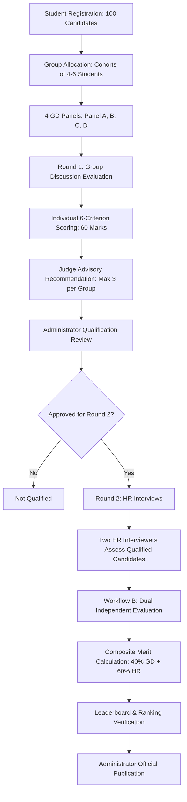

# PlacePro Evaluate — Evaluation Workflow & Business Rules

Detailed operational lifecycle of the collegiate mock placement evaluation process.

---

## 1. Group Formation & Panel Allocation Rules
- Each group must have between **4 and 6 participants** (inclusive).
- Groups must be allocated to exactly one of the **4 panels (Panel A, B, C, D)**.
- A candidate cannot be assigned to two active groups simultaneously.
- If unassigned students remain, the administrator uses the **Auto-Distribute** engine to partition candidates into balanced cohorts of 5.

---

## 2. Round 1 — Group Discussion Live Scoring
- Even though candidates discuss as a group, **evaluations are strictly individual**.
- Rubrics (Total 60 Marks):
  1. Communication Skills (10)
  2. Clarity of Thought (10)
  3. Confidence and Poise (10)
  4. Logical Reasoning (10)
  5. Teamwork and Listening (10)
  6. Initiative and Leadership (10)
- Individual qualitative remarks are **mandatory** on final submission.
- Fast evaluation interface provides **Previous Student** and **Next Student** controls.

---

## 3. Strict 3-Student Shortlist Ceiling
- Each judge can recommend a **maximum of 3 students per group** for Round 2.
- The UI counter displays `"X of 3 candidates selected"`.
- Attempting to check a 4th candidate immediately triggers a validation block.
- Advisory shortlists do not automatically qualify candidates — **Administrator approval is mandatory**.

---

## 4. Round 2 — HR Interviews
- **Strict Eligibility**: Only candidates with status `qualified` can be scheduled.
- Two HR Interviewers (HR 1: Vikram Patel, HR 2: Sneha Gupta).
- Rubrics (Total 50 Marks):
  1. Communication Skills (10)
  2. Confidence and Professionalism (10)
  3. Problem-Solving Ability (10)
  4. Technical Awareness (10)
  5. Attitude and Career Motivation (10)
- Qualitative feedback captured: Key Strengths, Areas for Development, and Overall Verdict (`Strongly Recommended`, `Recommended`, `On Hold`, `Not Recommended`).
- Both HR evaluations are stored separately without overwriting.

---

## 5. Final Scoring, Tie-Breaking & Publication
- **Default Weights**: 40% Round 1 GD + 60% Round 2 HR.
- **Combined HR Score**: Arithmetic mean of the two normalized percentages.
- **Tie-Breaking Order**:
  1. Higher Composite Final Score
  2. Higher HR Interview Score
  3. Higher GD Score
- Administrator verifies the **Pre-Publication Checklist** and freezes the official standings.
